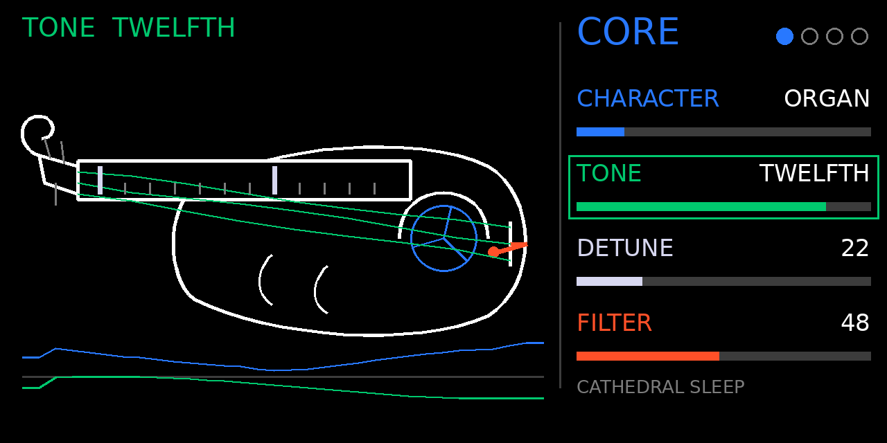

# DRIFTMAKER

An atmospheric drone synth engine for the original OP-1, running on **Opus 2 beta 4**. It was inspired by Fabula
Audio's Drone Maker, but it is an original engine: none of Drone Maker's code, samples or artwork is used.

One held note grows into a slowly moving environment. Eight sources morph into one another (hollow pipe, organ, two
choirs, bowed string, hurdy-gurdy, reed and bell). They pass through a layer voice, a resonant filter, two slow
modulators and a bloom over each note's first twelve seconds. Then degrade, grains and freeze, a delay and a dark
reverb work on the whole sound.



> **Status: not yet tried on an OP-1.** Everything below was tested on a computer: the engine's own C code in a model
> of the OP-1's voice handling, and the Blackfin build in the Blackfin instruction-set simulator. The first device test
> is still to do. [docs/TESTING.md](docs/TESTING.md) lists what was and wasn't tested.

## What you get

| | |
|---|---|
| `dist/driftmaker.opmod` | the engine, ready to copy to the OP-1 (39,168 bytes, Opus core 2.21 or later) |
| 4 pages × 4 values | CORE, MOTION, TEXTURE, SPACE: push an encoder for its page ([docs/PARAMETERS.md](docs/PARAMETERS.md)) |
| 16 presets | in the OP-1's own preset browser, folder `driftmaker` ([docs/PRESETS.md](docs/PRESETS.md)) |
| line-art page | a hurdy-gurdy drawn in the OP-1's encoder colours, with a turning wheel, lit tangents and live modulators |
| demo | `DRIFTMAKER_DEMO.mp4` and a preset-tour WAV, made by the scripts in [demo/](demo/) |

## Install (short version)

1. Opus 2 beta 4 must already be installed on the OP-1.
2. Connect the OP-1 in disk mode and copy `dist/driftmaker.opmod` into the **mods** folder.
3. Eject and restart the OP-1. Find **DRIFTMAKER** in Opus's mods list, then pick it as a synth engine.

The full steps, plus what to check on a first run, are in [docs/INSTALL.md](docs/INSTALL.md).

## Controls

Push an encoder to pick its page. Turn the four encoders to change that page's four values. Hold **shift** while
turning for a fine step.

| push | page | blue | green | white | orange |
|---|---|---|---|---|---|
| blue | **CORE** | character | tone | detune | filter |
| green | **MOTION** | rate 1 | depth 1 | rate 2 | depth 2 |
| white | **TEXTURE** | grain | freeze | density | degrade |
| orange | **SPACE** | reverb | delay | feedback | mix |

On CORE the four values are the OS's own knobs, so the OP-1's LFO can reach them. The envelope (T2) and LFO (T4)
pages are the OS's own and work as usual.

## CPU

The worst audio block measured in the Blackfin simulator was **122,545 cycles** (six high voices, every value at 99,
frozen grains), which is 21 % of the 580,525-cycle block. The simulator doesn't model memory stalls, so the figure
written to the manifest is 160,000 cycles (28 %), with a 30 % margin. Replace it with the device's own reading after the
first OP-1 test ([docs/TESTING.md](docs/TESTING.md#cpu)).

## Documents

- [docs/INSTALL.md](docs/INSTALL.md): installing, first run and the device checklist
- [docs/BUILD.md](docs/BUILD.md): building the `.opmod`, the tests and the demo
- [docs/PARAMETERS.md](docs/PARAMETERS.md): every value and what it does
- [docs/PRESETS.md](docs/PRESETS.md): the sixteen presets
- [docs/TESTING.md](docs/TESTING.md): the test and performance report
- [docs/KNOWN_LIMITATIONS.md](docs/KNOWN_LIMITATIONS.md): what it doesn't do, and what is still unknown

## Layout

```
engine/sammi.driftmaker/   the engine: glue, voices, effects, page, presets, tables, manifest, cpu.txt
host/                      the engine on a computer: a model of the OS, tests, renders, the page's drawing calls
sim/                       the Blackfin simulator harness: cycle counts, and audio compared with the host's
tools/                     table generator, raw-to-WAV, page preview renderer
demo/                      the demo's score and video assembly
art/                       page previews drawn from the page code
dist/                      the built .opmod
docs/                      documents, and docs/evidence/: build log, opmod listing, simulator cycles, host tests
third_party/               the Opus 2 plugin kit (beta 4), vendored without its toolchain builder
```

## Licence

GPL-3.0-or-later. Copyright (C) 2026 Sammi. The vendored Opus plugin kit keeps its own licence
(`third_party/opus-plugin-kit/LICENSE`). The full licence text is in [LICENSE](LICENSE).
